# Diagramme de Base de Données - Système d'Annonces

## Vue d'ensemble du Modèle de Données

```mermaid
erDiagram
    %% Table principale des annonces
    ads {
        int id PK
        int user_pp_id FK
        int is_draft
        int accept_share_contact_infos
        string title
        text about_content
        text about_project_content
        int project_id FK
        text support_request_text
        timestamp created_at
        timestamp updated_at
        timestamp deleted_at
        int is_partner
        int support_request_id_region FK
        int support_request_territory_id FK
        string origin
        int department_id FK
        int third_party_ad_user_id FK
    }

    %% Table d'attribution et modération
    attribution_ads {
        int id PK
        int ad_id FK
        int user_advisor_id FK
        int user_advisor_2_id FK
        int user_advisor_3_id FK
        int user_advisor_4_id FK
        int user_moderator_id FK
        int user_supervisor_id FK
        int ad_status_id FK
        int refusal_type_id FK
        timestamp published_on
        timestamp refused_on
        timestamp archived_at
        text short_description
        boolean to_call_back
        timestamp created_at
        timestamp updated_at
    }

    %% Types d'annonces spécifiques
    land_offer_ads {
        int id PK
        int ad_id FK
        boolean accept_use_zip_code
        float surface
        text sau_description
        boolean water_access
        text water_access_description
        float altitude
        boolean has_buildings
        boolean has_houses
        float price
        float rent_price
        text test_description
        int building_id FK
        int house_id FK
        boolean is_beneficiary
        boolean is_activity_transfer
        boolean is_call_for_application_community
        boolean is_call_for_application_terre_de_liens
        boolean is_call_for_application_test_area
        timestamp created_at
        timestamp updated_at
    }

    land_seek_ads {
        int id PK
        int ad_id FK
        int installation_type_id FK
        boolean is_bio
        string production_type_add
        text land_description
        text experience_farming
        int surface_range_min
        int surface_range_max
        int price_max
        int rent_max
        timestamp created_at
        timestamp updated_at
    }

    job_offer_ads {
        int id PK
        int ad_id FK
        boolean is_activity_transmission
        text job_description
        text experience_farming
        timestamp created_at
        timestamp updated_at
    }

    job_seek_ads {
        int id PK
        int ad_id FK
        text experience_farming
        timestamp created_at
        timestamp updated_at
    }

    associate_offer_ads {
        int id PK
        int ad_id FK
        boolean accept_use_zip_code
        float surface
        float altitude
        tinyint water_access
        boolean has_buildings
        boolean has_houses
        text associate_description
        text experience_farming
        boolean is_activity_transmission
        timestamp created_at
        timestamp updated_at
    }

    associate_seek_ads {
        int id PK
        int ad_id FK
        boolean is_land_already_found
        text land_description
        text associate_description
        text experience_farming
        timestamp created_at
        timestamp updated_at
    }

    %% Système de localisation polymorphe
    locationable_ads {
        int id PK
        int ad_id FK
        int locationable_ad_id
        string locationable_ad_type
        string radius
        timestamp created_at
        timestamp updated_at
    }

    %% Entités géographiques
    cities {
        int id PK
        string name
        string code
        int department_id FK
        timestamp created_at
        timestamp updated_at
    }

    departments {
        int id PK
        string name
        string code
        int region_id FK
        timestamp created_at
        timestamp updated_at
    }

    regions {
        int id PK
        string name
        string code
        timestamp created_at
        timestamp updated_at
    }

    territories {
        int id PK
        string name
        string code
        timestamp created_at
        timestamp updated_at
    }

    %% Système de favoris
    favorite_ads {
        int id PK
        int user_id FK
        int ad_id FK
        timestamp created_at
        timestamp updated_at
    }

    %% Système de conversations
    threads {
        int id PK
        text title
        boolean is_private
        int ad_id FK
        timestamp created_at
        timestamp updated_at
    }

    messages {
        int id PK
        int thread_id FK
        int sender_user_id FK
        text content
        timestamp created_at
        timestamp updated_at
    }

    %% Notes internes
    ad_notes {
        int id PK
        int ad_id FK
        int user_id FK
        int project_data_key_id FK
        int project_data_value_id FK
        text value
        string contact_name
        timestamp created_at
        timestamp updated_at
    }

    %% Système de documents polymorphe
    documents {
        int id PK
        string name
        string path
        string type
        int size
        int user_id FK
        timestamp created_at
        timestamp updated_at
    }

    documentables {
        int id PK
        int document_id FK
        int documentable_id
        string documentable_type
        timestamp created_at
        timestamp updated_at
    }

    %% Système de production polymorphe
    production_genres {
        int id PK
        string name
        string code
        timestamp created_at
        timestamp updated_at
    }

    productionable_genres {
        int id PK
        int production_genre_id FK
        int productionable_genre_id
        string productionable_genre_type
        enum type
        timestamp created_at
        timestamp updated_at
    }

    %% Utilisateurs et rôles
    users {
        int id PK
        string name
        string email
        int role
        timestamp created_at
        timestamp updated_at
    }

    third_party_ad_users {
        int id PK
        string name
        string email
        string source
        timestamp created_at
        timestamp updated_at
    }

    %% Tables de référence
    ad_statuses {
        int id PK
        string name
        string code
        timestamp created_at
        timestamp updated_at
    }

    response_templates {
        int id PK
        string name
        text content
        timestamp created_at
        timestamp updated_at
    }

    installation_types {
        int id PK
        string name
        string code
        timestamp created_at
        timestamp updated_at
    }

    buildings {
        int id PK
        string name
        string description
        timestamp created_at
        timestamp updated_at
    }

    houses {
        int id PK
        string name
        string description
        timestamp created_at
        timestamp updated_at
    }

    project_data_keys {
        int id PK
        string name
        string code
        timestamp created_at
        timestamp updated_at
    }

    project_data_values {
        int id PK
        int project_data_key_id FK
        string value
        timestamp created_at
        timestamp updated_at
    }

    %% Historique
    history {
        int id PK
        int ads_id
        string ads_type
        text changes
        timestamp created_at
        timestamp updated_at
    }

    %% Relations principales
    ads ||--o{ attribution_ads : "has one"
    ads ||--o{ land_offer_ads : "polymorphic"
    ads ||--o{ land_seek_ads : "polymorphic"
    ads ||--o{ job_offer_ads : "polymorphic"
    ads ||--o{ job_seek_ads : "polymorphic"
    ads ||--o{ associate_offer_ads : "polymorphic"
    ads ||--o{ associate_seek_ads : "polymorphic"
    ads ||--o{ locationable_ads : "has many"
    ads ||--o{ favorite_ads : "has many"
    ads ||--o{ threads : "has many"
    ads ||--o{ ad_notes : "has many"
    ads ||--o{ documentables : "polymorphic"
    ads ||--o{ productionable_genres : "polymorphic"
    ads ||--o{ history : "polymorphic"

    %% Relations utilisateurs
    users ||--o{ ads : "creates"
    users ||--o{ attribution_ads : "advisor 1"
    users ||--o{ attribution_ads : "advisor 2"
    users ||--o{ attribution_ads : "advisor 3"
    users ||--o{ attribution_ads : "advisor 4"
    users ||--o{ attribution_ads : "moderator"
    users ||--o{ attribution_ads : "supervisor"
    users ||--o{ favorite_ads : "has many"
    users ||--o{ ad_notes : "creates"
    users ||--o{ documents : "owns"
    users ||--o{ messages : "sends"
    third_party_ad_users ||--o{ ads : "creates"

    %% Relations géographiques
    regions ||--o{ departments : "contains"
    departments ||--o{ cities : "contains"
    departments ||--o{ ads : "main department"
    regions ||--o{ ads : "support region"
    territories ||--o{ ads : "support territory"
    cities ||--o{ locationable_ads : "polymorphic"
    departments ||--o{ locationable_ads : "polymorphic"
    regions ||--o{ locationable_ads : "polymorphic"

    %% Relations de référence
    ad_statuses ||--o{ attribution_ads : "status"
    response_templates ||--o{ attribution_ads : "refusal type"
    installation_types ||--o{ land_seek_ads : "type"
    buildings ||--o{ land_offer_ads : "has"
    houses ||--o{ land_offer_ads : "has"
    production_genres ||--o{ productionable_genres : "type"
    project_data_keys ||--o{ ad_notes : "key"
    project_data_keys ||--o{ project_data_values : "belongs to"
    project_data_values ||--o{ ad_notes : "value"

    %% Relations documents
    documents ||--o{ documentables : "attached to"
    
    %% Relations conversations
    threads ||--o{ messages : "contains"
```

## Légende des Relations

### Types de Relations
- **1:1** (||--||) : Relation un-à-un
- **1:N** (||--o{) : Relation un-à-plusieurs
- **N:N** (}o--o{) : Relation plusieurs-à-plusieurs (via table pivot)
- **Polymorphe** : Relation polymorphe Laravel

### Contraintes de Clés Étrangères
- **CASCADE DELETE** : Suppression en cascade
- **CASCADE UPDATE** : Mise à jour en cascade
- **RESTRICT** : Empêche la suppression
- **SET NULL** : Définit à NULL lors de la suppression

### Types de Données
- **int** : Entier
- **string** : Chaîne de caractères
- **text** : Texte long
- **float** : Nombre décimal
- **boolean** : Booléen
- **timestamp** : Date et heure
- **enum** : Énumération

## Patterns Architecturaux Identifiés

### 1. Polymorphisme
- **Types d'annonces** : 6 tables spécifiques (land_offer_ads, land_seek_ads, etc.)
- **Localisation** : locationable_ads pour Cities/Departments/Regions
- **Documents** : documentables pour Ads/Projects
- **Production** : productionable_genres pour différents types d'annonces

### 2. Soft Delete
- **ads** : Utilise `deleted_at` pour la suppression logique
- **Cascade physique** : Les tables liées sont supprimées physiquement

### 3. Multi-Attribution
- **AttributionAd** : Support de 4 conseillers + 1 modérateur + 1 superviseur
- **Hiérarchie** : Système de permissions par rôles et départements

### 4. Audit Trail
- **history** : Table polymorphe pour la traçabilité
- **Timestamps** : created_at/updated_at sur toutes les tables

### 5. Géolocalisation Flexible
- **Hiérarchie** : Région → Département → Ville
- **Territoire** : Regroupement transversal pour l'accompagnement
- **Polymorphe** : Une annonce peut être liée à plusieurs types de localisation

## Considérations Techniques

### Performance
- **Index** : Toutes les clés étrangères sont indexées
- **Soft Delete** : Index sur `deleted_at` pour les requêtes rapides
- **Polymorphe** : Index composés sur type + id

### Évolutivité
- **Nouveaux types d'annonces** : Architecture polymorphe extensible
- **Nouvelles localisations** : Système polymorphe flexible
- **Intégrations** : Support des utilisateurs tiers et synchronisation Salesforce

### Intégrité
- **Contraintes** : Foreign keys avec actions appropriées
- **Validation** : Contraintes métier dans les modèles Laravel
- **Cohérence** : Transactions pour les opérations complexes