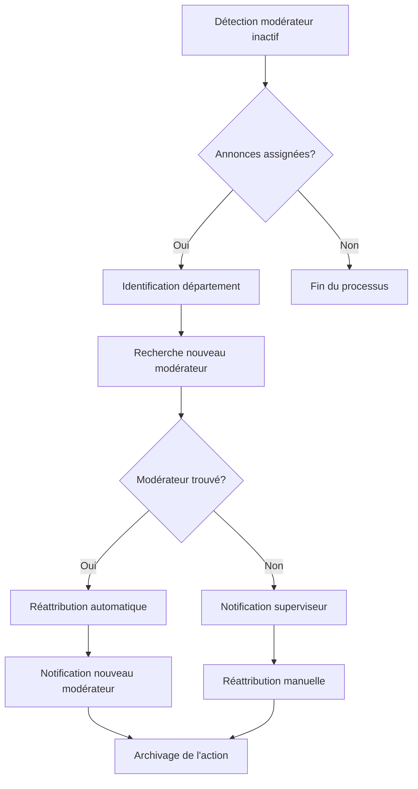

# Processus de Modération et d'Attribution des Annonces

## Vue d'ensemble

Le processus de modération et d'attribution des annonces dans Objectif Terres est un système automatisé qui assigne les annonces aux modérateurs compétents en fonction de critères géographiques et de disponibilité.

## Flux Global du Processus

```
1. Publication d'annonce → 2. Attribution automatique → 3. Notification → 4. Modération → 5. Publication ou refus
```

## Diagramme de Flux Complet

```mermaid
graph TD
    A[Porteur de Projet crée une annonce] --> B{Annonce en brouillon?}
    B -->|Oui| C[Sauvegarde sans attribution]
    B -->|Non| D[Demande de publication]
    C --> E[Porteur décide de publier]
    E --> D
    
    D --> F[AdService::requestPublishing()]
    F --> G[Récupération département principal]
    G --> H[ad.main_department.code]
    
    H --> I{Annonce déjà attribuée?}
    I -->|Oui| J{Modérateur toujours disponible?}
    I -->|Non| K[Recherche nouveau modérateur]
    
    J -->|Oui| L[Conserver modérateur actuel]
    J -->|Non| K
    
    K --> M[1. Utilisateur permission spéciale]
    M --> N{Trouvé?}
    N -->|Oui| O[Attribution utilisateur permission 1]
    N -->|Non| P[2. Modérateurs standards rôle 1]
    
    P --> Q{Trouvé?}
    Q -->|Oui| R[Sélection aléatoire parmi modérateurs]
    Q -->|Non| S[3. Responsables territoriaux rôle 3]
    
    S --> T{Trouvé?}
    T -->|Oui| U[Sélection aléatoire parmi superviseurs]
    T -->|Non| V[4. Modérateur par défaut ID 18552]
    
    O --> W[Création/MAJ AttributionAd]
    R --> W
    U --> W
    V --> W
    L --> W
    
    W --> X[Statut: PENDING_MODERATION_STATUS_ID]
    X --> Y[Notification au modérateur]
    Y --> Z[Notification au porteur de projet]
    
    Z --> AA[Modérateur traite l'annonce]
    AA --> BB{Décision modérateur}
    
    BB -->|Accepter| CC[Statut: APPROVE_ID]
    BB -->|Refuser| DD[Statut: REFUSE_ID]
    BB -->|Demander modifications| EE[Statut: PENDING_ID]
    
    CC --> FF[published_on = now()]
    CC --> GG[Notification acceptation]
    
    DD --> HH[refused_on = now()]
    DD --> II[Notification refus avec motif]
    
    EE --> JJ[Notification demande modifications]
    JJ --> KK[Porteur modifie l'annonce]
    KK --> D
    
    FF --> LL[Annonce publiée sur le site]
    LL --> MM[Surveillance expiration 6 mois]
    MM --> NN{6 mois écoulés?}
    NN -->|Oui| OO[Statut: ARCHIVED_ID]
    NN -->|Non| PP[Annonce reste active]
    
    OO --> QQ[Notification avant expiration]
    QQ --> RR[Dépublication automatique]
    
    style A fill:#e1f5fe
    style D fill:#fff3e0
    style W fill:#f3e5f5
    style CC fill:#e8f5e8
    style DD fill:#ffebee
    style EE fill:#fff8e1
    style LL fill:#e8f5e8
    style OO fill:#fafafa
```

## Règles d'Attribution Automatique

### 1. Critères Géographiques

L'attribution se base sur le **département principal** de l'annonce :
- Le système récupère le département principal via `$ad->main_department->code`
- L'annonce est attribuée aux modérateurs ayant des permissions sur ce département

### 2. Hiérarchie des Modérateurs

Le système recherche des modérateurs disponibles dans l'ordre suivant :

#### 2.1 Réattribution Prioritaire
- **Si l'annonce a déjà été attribuée** : le même modérateur est maintenu s'il est toujours disponible
- Condition : `$ad->attributionAd->userModerator` existe et est dans la liste des modérateurs disponibles

#### 2.2 Utilisateur avec Permissions Spéciales
- **Priorité 1** : Utilisateur avec permission spéciale (code 1) dans le département
- Recherche via `findOneByUserPermissionAndDepartments(1, $departmentCodes)`

#### 2.3 Modérateurs Standards
- **Priorité 2** : Modérateurs (rôle 1) dans le département
- Recherche via `findByRolesAndDepartments([1], $departmentCodes)`
- **Sélection aléatoire** si plusieurs modérateurs disponibles

#### 2.4 Responsables Territoriaux
- **Priorité 3** : Responsables territoriaux (rôle 3) dans le département
- Recherche via `findByRolesAndDepartments([3], $departmentCodes)`
- **Sélection aléatoire** si plusieurs responsables disponibles

#### 2.5 Modérateur par Défaut
- **Dernier recours** : Utilisateur ID 18552 (objectif-terres@terredeliens.org)
- Utilisé si aucun modérateur n'est trouvé dans le département

### 3. Cas d'Erreur

Si aucun modérateur n'est trouvé dans le département :
- **Exception levée** : `AttributionAdException`
- **Message** : "Aucun modérateur n'a été trouvé dans votre région. Veuillez sauvegarder votre annonce et nous contacter."

## Statuts et États des Annonces

### 1. Statut d'Attribution
- **PENDING_MODERATION_STATUS_ID** : Annonce en attente de modération
- Attribution automatique lors de la demande de publication

### 2. Mise à Jour des Attributions
- **Nouvelle attribution** : Création d'un enregistrement `AttributionAd`
- **Réattribution** : Mise à jour de l'enregistrement existant
- **Condition** : L'annonce ne doit pas être refusée ou archivée

## Notifications Automatiques

### 1. Notification au Modérateur
- **Type** : `NewAdToModerateNotification`
- **Destinataire** : Modérateur assigné
- **Contenu** : Informations sur l'annonce à modérer

### 2. Notification au Porteur de Projet
- **Type** : `PendingModerationNotification`
- **Destinataire** : Créateur de l'annonce
- **Contenu** : Confirmation de soumission pour modération

## Processus Technique

### 1. Méthode Principale
```php
AdService::requestPublishing(Ad $ad)
```

### 2. Étapes d'Exécution
1. **Récupération du département** : `$ad->main_department->code`
2. **Recherche des modérateurs** selon la hiérarchie
3. **Vérification de disponibilité** des modérateurs
4. **Attribution** selon les priorités
5. **Création/mise à jour** de l'enregistrement `AttributionAd`
6. **Envoi des notifications**

### 3. Gestion des Transactions
- **Transaction DB** : Processus atomique pour éviter les incohérences
- **Rollback automatique** en cas d'erreur

## Cas Particuliers

### 1. Annonces Importées
- **Processus** : `AdService::importAd()`
- **Statut** : `APPROVE_ID` (pré-approuvées)
- **Attribution** : Modérateur assigné mais annonce déjà publiée

### 2. Annonces Brouillons
- **Condition** : `$data["is_draft"] = true`
- **Comportement** : Pas d'attribution automatique
- **Attribution** : Seulement lors de la demande de publication

### 3. Réattribution
- **Condition** : Annonce déjà attribuée mais modérateur indisponible
- **Comportement** : Nouveau modérateur selon les règles standard
- **Conservation** : Historique des attributions

## Gestion des Modérateurs Inactifs

### 1. Détection d'Inactivité

#### Utilisateurs Supprimés (Soft Delete)
- **Champ** : `users.deleted_at IS NOT NULL`
- **Impact** : Utilisateur exclu de toutes les requêtes d'attribution
- **Utilisation** : `User::withTrashed()` nécessaire pour accéder aux utilisateurs supprimés

#### Changement de Rôle
- **Condition** : `users.role < 1` (devient Porteur de Projet)
- **Impact** : Exclu automatiquement des recherches de modérateurs
- **Requête** : `whereIn('role', [1,3,4])` exclut les rôles inférieurs

#### Permissions Révoquées
- **Condition** : Perte de permission spéciale (code 1)
- **Impact** : Exclu des recherches `findOneByUserPermissionAndDepartments(1, ...)`
- **Effet** : Retour au niveau modérateur standard ou exclusion complète

### 2. Filtrage Automatique

#### Dans les Requêtes d'Attribution
```php
// UserService::findByRolesAndDepartments()
User::filterSubLocations('departments', $departmentCodes, 'departments.code')
    ->whereIn('role', $rolesId)  // Exclut automatiquement les rôles < 1
    ->get();
```

#### Dans les Recherches de Permissions
```php
// UserRepository::findAllByUserPermissionAndDepartments()
User::filterSubLocations('departments', $departmentCodes, 'departments.code')
    ->whereHas('userPermissions', function($builder) use($permission){
        $builder->where('permission', '=', $permission);
    })
    ->get();
```

### 3. Problèmes Identifiés

#### Annonces Déjà Attribuées
- **Problème** : Annonces déjà attribuées à un modérateur devenu inactif
- **Impact** : Annonces restent assignées à un modérateur qui ne peut plus les traiter
- **Statuts concernés** : `PENDING_MODERATION_STATUS_ID`, `PENDING_ID`, `APPROVE_ID`, `REFUSE_ID`

#### Absence de Vérification
- **Problème** : Pas de vérification de l'activité du modérateur lors de la réattribution
- **Code** : `AdService::requestPublishing()` ligne 215-220
```php
if ($ad->attributionAd && $ad->attributionAd->userModerator &&
    $availableModerators->contains($ad->attributionAd->userModerator)) {
    $assignedModerator = $ad->attributionAd->userModerator;
}
```

### 4. Solutions Existantes

#### Action Nova de Réattribution
- **Classe** : `ReallocateModeratorAds`
- **Fonctionnalité** : Réattribution manuelle via interface Nova
- **Processus** :
  1. Sélection du modérateur inactif
  2. Choix du nouveau modérateur
  3. Transfert de toutes les annonces (`PENDING_ID`, `PENDING_MODERATION_STATUS_ID`, `APPROVE_ID`, `REFUSE_ID`)

#### Modérateurs Éligibles
```php
// Modérateurs, Superviseurs, Admins
User::whereIn('role', [1,3,4])
    ->get()
    ->concat(
        // Conseillers avec permission spéciale
        User::where('role', 2)
            ->whereHas('userPermissions', function ($query) {
                $query->where('permission', 1);
            })->get()
    )
```

#### Avertissement Système
- **Message** : "Attention, si le modérateur d'origine n'est pas supprimé, il peut être à nouveau choisi dans le processus d'attribution automatique."
- **Implication** : Nécessité de supprimer/désactiver le modérateur après réattribution

### 5. Lacunes Actuelles

#### Pas de Vérification Automatique
- **Problème** : Aucun processus automatique pour détecter les modérateurs inactifs
- **Impact** : Dépendance sur la détection manuelle

#### Pas de Réattribution Automatique
- **Problème** : Pas de système automatique de réattribution
- **Impact** : Annonces bloquées jusqu'à intervention manuelle

#### Pas de Notification
- **Problème** : Pas d'alerte automatique quand un modérateur devient inactif
- **Impact** : Retard dans la détection des problèmes

### 6. Recommandations

#### Vérification Préventive
- **Ajout** : Vérification de l'activité du modérateur dans `requestPublishing()`
- **Implémentation** : Vérifier `deleted_at` et `role` avant réattribution

#### Processus Automatique
- **Command Artisan** : Commande de détection des modérateurs inactifs
- **Scheduler** : Exécution périodique pour identifier les problèmes

#### Monitoring
- **Métriques** : Suivi des annonces non traitées par département
- **Alertes** : Notifications aux superviseurs en cas de problème

#### Réattribution Intelligente
- **Algorithme** : Réattribution automatique selon les règles existantes
- **Notification** : Alerte au nouveau modérateur et à l'équipe

### 7. Workflow Recommandé



### 8. Statuts d'Attribution Concernés

#### Annonces à Réattribuer
- **PENDING_MODERATION_STATUS_ID (4)** : À modérer
- **PENDING_ID (2)** : En attente de réponse
- **APPROVE_ID (1)** : Validées (pour suivi)
- **REFUSE_ID (3)** : Refusées (pour suivi)

#### Annonces Non Concernées
- **ARCHIVED_ID (5)** : Archivées automatiquement
- **Brouillons** : `is_draft = 1`

## Modèles de Données Impliqués

### 1. Table `ads`
- Contient les informations de base de l'annonce
- Référence au créateur (`user_pp_id`)

### 2. Table `attribution_ads`
- Lien entre annonce et modérateur
- Statut de modération
- Dates de publication et d'archivage

### 3. Table `users`
- Informations sur les modérateurs
- Rôles et permissions départementales

## Règles Métier

### 1. Géographie
- **Une annonce** = **Un département principal**
- **Modérateurs** = **Assignés par département**
- **Territoires** = **Regroupements de départements**

### 2. Rôles et Permissions
- **Rôle 1** : Modérateur standard
- **Rôle 3** : Responsable territorial (peut modérer)
- **Permissions spéciales** : Utilisateurs avec droits étendus

### 3. Disponibilité
- **Modérateurs actifs** : Non supprimés, avec permissions sur le département
- **Sélection aléatoire** : Répartition équitable de la charge

## Monitoring et Suivi

### 1. Historique
- **Traçabilité** : Toutes les attributions sont enregistrées
- **Changements** : Notifications automatiques des changements de rôle

### 2. Métriques
- **Temps de traitement** : Suivi des délais de modération
- **Charge de travail** : Répartition par modérateur

### 3. Alertes
- **Modérateurs manquants** : Alertes si pas de modérateur dans un département
- **Retards** : Notifications pour les modérations en retard